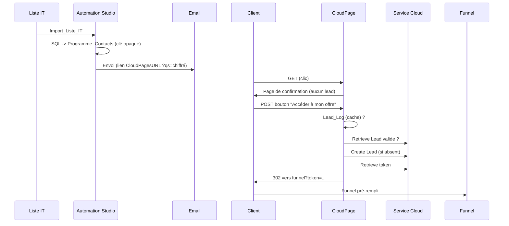

# sfmc_lead_generation

Création des leads **au clic** (et non à l'envoi) pour le programme de
migration de produits : le lead est créé dans Service Cloud au moment où le
client clique dans l'email, puis il est redirigé vers le sales funnel avec le
token du lead. Les 70 jours de validité démarrent donc à l'engagement réel du
client, et seuls les clients intéressés génèrent un lead.

## Flux

## Contenu

| Fichier | Rôle |
|---|---|
| `cloudpage/lead-redirect.html` | CloudPage : validation de la clé, confirmation, création/réutilisation du lead, redirection |
| `email/link-snippet.ampscript` | Construction du lien dans l'email |
| `sql/01_generate_programme_contacts.sql` | Import des contacts et génération des clés opaques stables |
| `docs/data-extensions.md` | Schéma des Data Extensions |
| `docs/salesforce-checklist.md` | Points à valider avec l'admin Salesforce |
| `tests/test-plan.md` | Plan de test |
| `samples/import_liste_it.csv` | Données factices pour la recette |

## Mise en place

1. Créer les DE décrites dans `docs/data-extensions.md`.
2. Passer la checklist `docs/salesforce-checklist.md` avec l'admin Salesforce.
3. Importer la liste IT dans `Import_Liste_IT`, puis planifier la requête SQL
   (action **Update**, jamais Overwrite : les clés restent stables).
4. Créer et publier la CloudPage avec `cloudpage/lead-redirect.html` ; adapter
   le bloc *Configuration* (URL du funnel, noms des DE, champ du token).
5. Dans l'email, utiliser `email/link-snippet.ampscript` avec l'ID de la
   CloudPage.
6. Exécuter `tests/test-plan.md` avant le premier envoi.

## Choix de conception

- **Aucune donnée dans le lien.** Le lien ne porte qu'une clé opaque (GUID),
  chiffrée par `CloudPagesURL` : pas de données personnelles dans l'URL,
  rien de modifiable. `Base64Encode` n'est pas du chiffrement.
- **Données de pré-remplissage dans une DE** (`Programme_Contacts`) plutôt que
  `RetrieveSalesforceObjects` sur le Contrat : pas d'appel API
  supplémentaire. Le Retrieve sur Contrat reste possible pour des données qui
  doivent être fraîches : l'`Id` du contrat vient alors de la DE.
- **Page de confirmation.** Les scanners de liens font des GET : ils
  n'atteignent jamais l'étape de création, seul le POST du bouton crée un lead.
- **Anti-doublon en trois niveaux** : `Lead_Log` (0 appel API), puis
  `RetrieveSalesforceObjects` sur Lead (même contrat + même programme +
  créé depuis moins de 60 jours), puis création.
- **Marge de 60 jours** (au lieu de 70) : le client dispose d'au moins 10
  jours pour terminer le funnel avec un lead réutilisé.
- **Repli** : en cas d'échec de création ou de token vide, redirection vers le
  lien générique du funnel (`?partner=hesitating`, sans pré-remplissage) et trace dans `Lead_Error_Log`.
  Une clé inconnue ou un programme terminé sont aussi redirigés vers ce lien
  générique, sans trace d'erreur.

## Limites connues

- **Course sur deux clics simultanés** : `Lead_Log` n'est écrit qu'après la
  création, donc deux POST quasi simultanés peuvent créer deux leads. Le
  bouton rend le cas rare. Pour l'éliminer, il faudrait une contrainte
  d'unicité côté Salesforce (voir `docs/salesforce-checklist.md`).
- **Un lead créé hors de cette page** et retrouvé via Retrieve n'est pas écrit
  dans `Lead_Log` (sa date de création réelle n'est pas stockée) : chaque clic
  coûte alors un appel API.
- `RetrieveSalesforceObjects` est lent et consomme du quota API : surveiller
  les volumes. Si le volume le justifie, remplacer ce Retrieve par une DE
  synchronisée (Synchronized Data Extensions) sur Lead.
- Le code AMPScript n'a pas pu être exécuté ici : la recette dans une BU de
  test (`tests/test-plan.md`) est indispensable.
