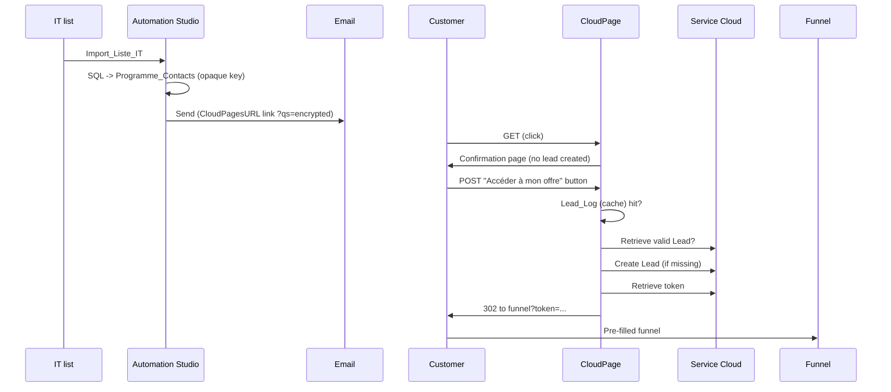

# sfmc_lead_generation

Creates Service Cloud leads **on click** (rather than at send time) for the
product-migration program. The lead is created when the customer clicks the link
in the email, and the customer is then redirected to the sales funnel with the
lead token. The 70-day lead validity therefore starts when the customer actually
engages, and only interested customers generate a lead.

## Flow

## Contents

| File | Purpose |
|---|---|
| `cloudpage/lead-redirect.html` | CloudPage: key validation, confirmation, lead creation/reuse, redirect |
| `email/link-snippet.ampscript` | Builds the link in the email |
| `sql/01_generate_programme_contacts.sql` | Imports contacts and generates stable opaque keys |
| `sql/02_histogramme_delais_clic.sql` | Send → click delay distribution (to choose the anti-bot threshold) |
| `sql/03_clics_suspects.sql` | Clicks < 5 s after the send, to exclude from statistics |
| `docs/data-extensions.md` | Data Extension schemas |
| `docs/salesforce-checklist.md` | Items to validate with the Salesforce admin |
| `tests/test-plan.md` | Test plan |
| `samples/import_liste_it.csv` | Dummy data for testing |

Identifiers (Data Extension names, field names, link alias) are kept in French
to match the existing environment. The customer-facing page copy and the email
button label are also in French, as the customers are French-speaking.

## Setup

1. Create the DEs described in `docs/data-extensions.md`.
2. Go through `docs/salesforce-checklist.md` with the Salesforce admin.
3. Import the IT list into `Import_Liste_IT`, then schedule the SQL query
   (data action **Update**, never Overwrite: keys must stay stable).
4. Create and publish the CloudPage with `cloudpage/lead-redirect.html`; adapt
   the *Configuration* block (funnel URL, DE names, token field).
5. In the email, use `email/link-snippet.ampscript` with the CloudPage ID.
6. Run `tests/test-plan.md` before the first send.

## Design decisions

- **No data in the link.** The link only carries an opaque key (GUID), encrypted
  by `CloudPagesURL`: no personal data in the URL and nothing a customer can
  tamper with. `Base64Encode` is encoding, not encryption.
- **Pre-fill data stored in a DE** (`Programme_Contacts`) rather than read with
  `RetrieveSalesforceObjects` on the Contract: no extra API call. A Retrieve on
  the Contract remains possible for data that must be fresh; the contract `Id`
  then comes from the DE.
- **Confirmation page.** Link scanners issue GET requests: they never reach the
  creation step, only the button's POST creates a lead.
- **Anti-bot check on the send delay.** The link carries the job send time
  (`GetSendTime()`, encrypted parameter `t`). A POST received less than
  `@cfgMinSeconds` seconds after the send (5 by default, 0 to disable) creates
  no lead and is logged in `Lead_Error_Log` ("SUSPECT"). Computed in SSJS
  because AMPscript `DateDiff` cannot go below one minute. Queries `sql/02` and
  `sql/03` help calibrate the threshold and clean click statistics.
- **Three-level duplicate prevention**: `Lead_Log` (0 API calls), then
  `RetrieveSalesforceObjects` on Lead (same contract + same program + created
  less than 60 days ago), then creation.
- **60-day margin** (instead of 70): a reused lead leaves the customer at least
  10 days to complete the funnel.
- **Fallback**: if lead creation fails or the token is empty, the customer is
  redirected to the generic funnel link (`?partner=hesitating`, no pre-fill) and
  the error is logged in `Lead_Error_Log`. An unknown key or an ended program is
  redirected to the same generic link, without an error log.

## Known limitations

- **Two simultaneous clicks**: `Lead_Log` is only written after creation, so two
  nearly simultaneous POSTs can create two leads. The button makes this rare.
  Eliminating it would require a uniqueness constraint in Salesforce (see
  `docs/salesforce-checklist.md`).
- **A lead created outside this page** and found through Retrieve is not written
  to `Lead_Log` (its real creation date is not stored): each click then costs an
  API call.
- `RetrieveSalesforceObjects` is slow and consumes API quota: monitor volumes.
  If volumes justify it, replace this Retrieve with a Synchronized Data
  Extension on Lead.
- The AMPscript/SSJS code has not been executed: testing in a test business unit
  (`tests/test-plan.md`) is mandatory.
